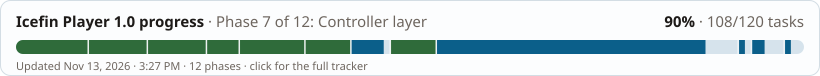
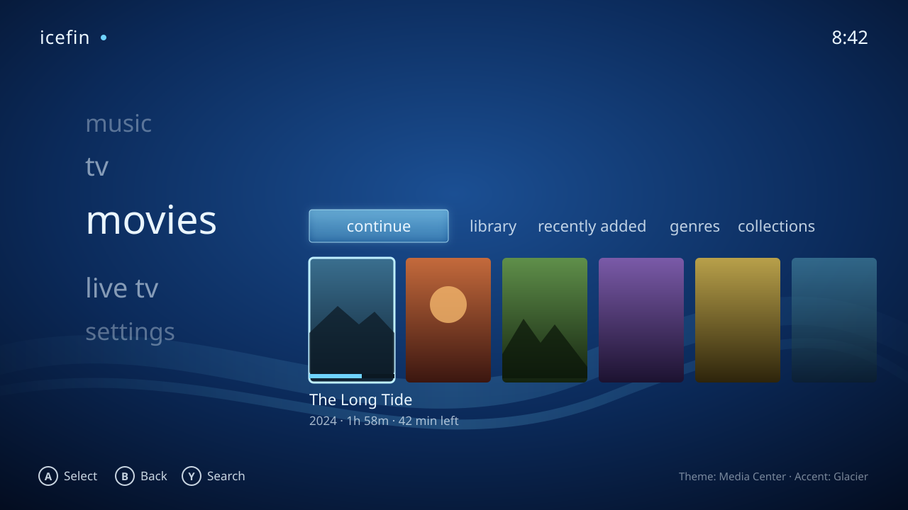
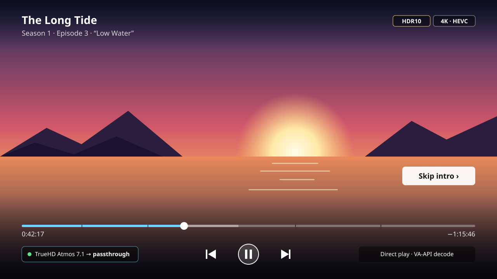
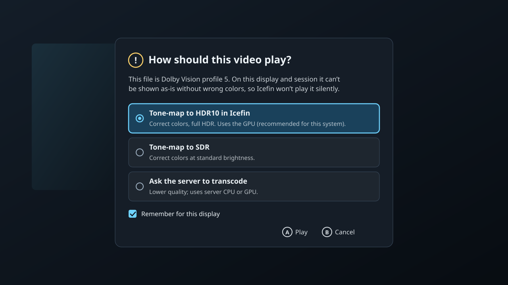
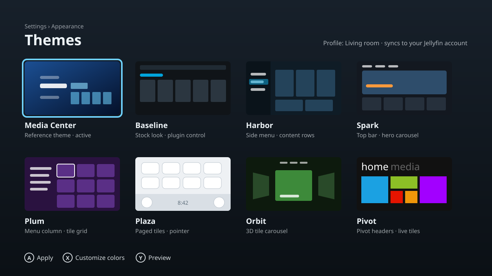

# Icefin Player

A themeable, HTPC-first Jellyfin client for Linux. Icefin Player is a fork of [Jellyfin Desktop](https://github.com/jellyfin/jellyfin-desktop) (v2.0.0). It adds a full theme engine, true HDR output, reliable HDMI audio passthrough and first-class controller support, and ships as a Flatpak.

> **Status:** pre-alpha. Planning is complete and development is starting. Nothing here is ready for daily use yet. Track progress in [`docs/PLAN.md`](docs/PLAN.md).

## What it will look like

These are design mock-ups of the 1.0 goals, not screenshots. Titles and artwork are placeholders.

<table>
  <tr>
    <td width="50%"></td>
    <td width="50%"></td>
  </tr>
  <tr>
    <td><b>Home, Media Center theme.</b> The 10-foot reference theme, fully driven by a controller or remote.</td>
    <td><b>HDR playback.</b> UI and video share one HDR surface, so controls and plugin overlays work over HDR10. Audio goes to the receiver bit-for-bit.</td>
  </tr>
  <tr>
    <td></td>
    <td></td>
  </tr>
  <tr>
    <td><b>Capability prompt.</b> When a source can't be shown correctly, Icefin asks instead of playing wrong colors.</td>
    <td><b>Theme picker.</b> The reference theme plus seven clone themes, chosen per user and synced through Jellyfin.</td>
  </tr>
</table>

## Goals

| Goal | What "done" means |
| --- | --- |
| **Keep every server plugin working** | Anything that works in the Jellyfin web client works in Icefin, with or without a theme active. |
| **Total UI conversion through themes** | Themes can replace the whole 10-foot interface (layout, navigation, motion, colors, sounds) without code changes to the engine. |
| **HDR on modern Linux** | HDR10 and HLG reach the display on KDE Plasma, GNOME and Gamescope (Steam Deck Game Mode and similar). SDR displays get properly tone-mapped video. |
| **HDMI audio passthrough** | AC3, E-AC3, DTS, DTS-HD MA and TrueHD reach an AV receiver on PipeWire and ALSA. AC3, E-AC3 and DTS also work on PulseAudio, and JACK gets clean multichannel PCM. |
| **Controllers as a first-class input** | Every screen works with Xbox-style, PlayStation, Nintendo and Steam Deck controllers, inside and outside Steam. |
| **GPU acceleration everywhere** | Hardware video decode on AMD, Intel and NVIDIA, and a GPU-rendered UI. |
| **Flatpak as the production package** | One sandboxed package that installs alongside the official Jellyfin Desktop. |

## How it works

**Built on Jellyfin Desktop.** Icefin keeps upstream's stack: Qt 6, Qt WebEngine running the server's own jellyfin-web, and libmpv for playback. Because the server's web client still runs inside Icefin, server plugins keep working with no extra effort. Icefin's changes live in their own directories with small, marked hooks into upstream code, so the fork can follow upstream releases.

**A theme engine, not a skin.** A theme-agnostic engine runs on top of jellyfin-web: router, screen templates, focus and navigation models, transitions, sounds and design tokens. Themes are installable packages, mostly declarative (JSON, CSS, sounds, fonts and shader effects), validated before they load and limited by trust level. Each user's theme choice and color overrides sync through their Jellyfin account.

**One surface for UI and HDR video.** Qt Quick renders on Vulkan, and a patched libmpv draws video through libplacebo into the same surface as the interface. The whole window is composited in linear light and output as HDR10. It is tagged for the compositor through Wayland's color-management protocol, or through Gamescope's Vulkan path. The web player's own controls, skip buttons and plugin overlays therefore work over HDR video unchanged. Machines without usable Vulkan fall back to upstream's OpenGL path in SDR. When a source can't be shown correctly on a given system, Icefin asks the user what to do instead of showing a wrong picture.

**Audio that respects the receiver.** Icefin reads the receiver's supported formats from HDMI ELD data and decides passthrough per track. It sets up PipeWire and PulseAudio passthrough at runtime, and can take the HDMI device exclusively through the standard device-reservation protocol. If a device fails to open, it falls back to PCM instead of playing silence.

**Measured, not assumed.** A hardware self-test records what each GPU decodes, and Icefin uses the result for playback routing and for the device profile it sends the server. A physical lab (HDR TVs, an AV receiver, controllers, remotes) gates every release.

**Wayland-first.** Icefin targets Wayland desktops and Gamescope. Native X11 desktops are not supported, though the X11 code path remains for Gamescope.

## Planned features

**Theme engine**
- Theme packages with design tokens, screen templates, motion presets, sounds and GPU shader backdrops
- Per-user theme, preset and color overrides synced through Jellyfin
- Settings screens generated from each theme's token schema
- Trust levels for themes: user-installed themes are declarative-only unless explicitly trusted
- Media Center reference theme inspired by the classic 10-foot media center look, with original art and sounds
- Seven clone themes that double as engine benchmarks, all Icefin-branded with original assets:
  - **Baseline**: the stock Jellyfin look, used as the control for plugin-compatibility testing
  - **Harbor**: side menu with content rows, modeled on Kodi's Estuary layout
  - **Spark**: top bar and hero carousel, modeled on the Fire TV layout
  - **Plum**: menu column beside a tile grid, modeled on the Roku TV layout
  - **Plaza**: paged tile grid with pointer navigation, modeled on the Wii Menu layout
  - **Orbit**: 3D tile carousel, modeled on the Xbox 360 NXE layout
  - **Pivot**: pivot headers and live tiles, modeled on the Xbox 360 Metro layout

**Video and HDR**
- Single-surface Vulkan renderer for UI and video
- HDR10 and HLG output on KDE Plasma 6.4+, GNOME 48+ and Gamescope, windowed or full screen
- libplacebo tone mapping and Dolby Vision profile 5/8 handling
- HDR capability detection, with a status page explaining why HDR is or isn't active
- Capability prompt when the current system can't show a source correctly
- Smarter device profile: direct play whenever the client can decode or tone-map locally

**Audio**
- Choice of PipeWire, PulseAudio, JACK or ALSA output
- Receiver capability detection from HDMI ELD
- Per-track passthrough decisions with sensible fallbacks
- Runtime PipeWire/PulseAudio passthrough setup and exclusive ALSA mode
- "Never silent" fallback, per-device audio delay, receiver volume over HDMI-CEC
- Audio test page for confirming formats on the receiver

**Controllers and input**
- SDL3 gamepad support with standard mappings for current controllers
- Steam Input cooperation and a recommended Steam layout
- Correct on-screen button prompts per controller family
- Per-controller remapping and a Nintendo-layout option
- Keyboard, HDMI-CEC, LIRC and five-way remote navigation throughout

**Performance and platform**
- Hardware decode self-test (VA-API, NVDEC, Vulkan Video) with a Hardware settings page
- GPU-rendered UI and GPU-accelerated web layer
- Gamescope mode for couch and Steam Deck use
- Flatpak with a signed repository, installable beside Jellyfin Desktop

## Roadmap

1.0 is planned in 12 phases (about 42 weeks of development): fork setup, platform spikes, audio, GPU and display, the single-surface renderer, playback routing, controllers, the theme engine, the clone themes, an upstream sync, hardening, and release. See [`docs/PLAN.md`](docs/PLAN.md) for tasks and [`docs/SPEC.md`](docs/SPEC.md) for the full design.

After 1.0, the plan is to become an independent fork of Jellyfin Desktop and then drop X11 entirely.

## Contributing

Issues and pull requests are welcome. See [CONTRIBUTING](.github/CONTRIBUTING.md) and [`docs/BRANCHING.md`](docs/BRANCHING.md) for how branches, upstream merges and releases work.

## Installing

Not available yet. Releases will ship as a Flatpak from a signed Icefin repository, with Flathub to follow after 1.0.

## Relationship to Jellyfin

Icefin Player is an independent fork and is not affiliated with or endorsed by the Jellyfin project. It is built on [Jellyfin Desktop](https://github.com/jellyfin/jellyfin-desktop) and works with any Jellyfin server, 10.11 and later.

The clone themes reproduce layouts and color schemes only. They contain no logos, icons, artwork, sounds, characters or proprietary fonts from Kodi, Amazon, Roku, Nintendo or Microsoft, and all product names belong to their owners.

## Credits

Icefin Player stands on a lot of open-source work:

- **[Jellyfin Desktop](https://github.com/jellyfin/jellyfin-desktop)** by the Jellyfin project and its contributors: the client Icefin is forked from. Its web-client integration, mpv player, input, MPRIS and settings systems are the foundation everything here builds on.
- **Jellyfin Media Player** and, before it, **Plex Media Player**: the earlier projects Jellyfin Desktop grew out of, whose authors created the original Qt + mpv desktop client design.
- **[Jellyfin](https://jellyfin.org)** and **[jellyfin-web](https://github.com/jellyfin/jellyfin-web)**: the server and web client Icefin talks to and runs.
- **[mpv](https://mpv.io)**, **[libplacebo](https://code.videolan.org/videolan/libplacebo)** and **[FFmpeg](https://ffmpeg.org)**: playback, rendering and decoding.
- **[MpvQt](https://invent.kde.org/libraries/mpvqt)** (KDE) and **[Qt](https://www.qt.io)**: the UI framework and its mpv integration.
- **[Kodi](https://kodi.tv)** and the Estuary skin authors: the layout reference for the Harbor theme.

Upstream copyright notices are preserved in the source. Thank you to everyone who built the pieces Icefin depends on.

## License

GPL-2.0, as inherited from Jellyfin Desktop. See [`LICENSE`](LICENSE).
