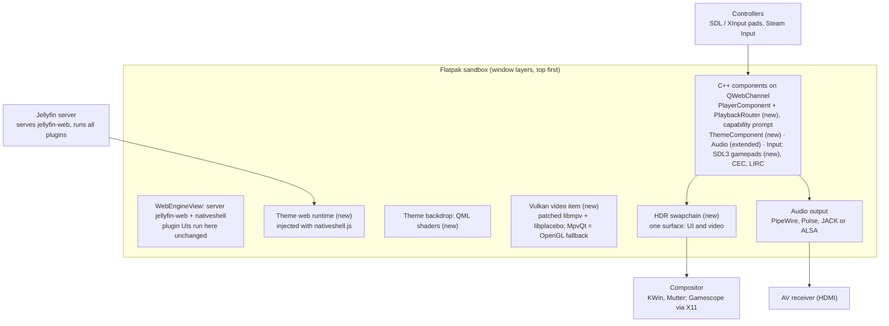
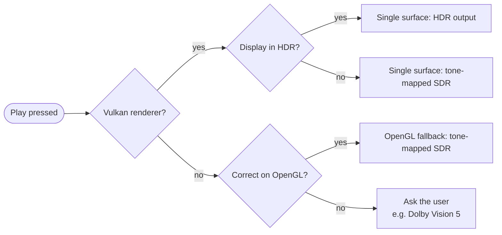

# Icefin Player — Development Spec

> Exported from the claude.ai plan doc on 2026-11-07 (doc rev 111). This is the design reference. Task tracking lives in `docs/PLAN.md`; decisions in `docs/DECISIONS.md`. The doc: https://claude.ai/artifact/H95okuizWUjCofUumXG1Mo

## Summary

Icefin Player is a fork of [jellyfin-desktop](https://github.com/jellyfin/jellyfin-desktop) v2.0.0 (tagged December 14, 2025). It keeps upstream's Qt WebEngine + jellyfin-web + libmpv stack, so every server plugin keeps working, and adds five things:

- a theme-engine layer, with Media Center as the reference theme and twelve clone themes as capability benchmarks: Baseline (stock Jellyfin, also the plugin-compatibility control) plus Kodi Estuary, Fire TV, Roku TV, Wii Menu, Xbox 360 NXE, Xbox 360 Metro, Apple TV, Netflix, TiVo guide, Steam Big Picture and PS3 XMB layouts, all Icefin-branded;
- a single-surface Vulkan renderer that draws the UI and HDR video into one window, on Wayland first with an X11 fallback for Gamescope;
- a hardened audio subsystem for HDMI passthrough on PipeWire, PulseAudio, JACK and ALSA;
- first-class controller support through SDL, Steam Input and Xbox-style (XInput) pads;
- verified GPU decode and rendering, shipped as a Flatpak.

Estimated effort: about 42 weeks for one developer to reach 1.0, including about 9 weeks for the clone themes. If the single-surface spike fails, the plan falls back to a two-window HDR design estimated at about 38 weeks.

**Decisions recorded (November 7, 2026)**

| Decision | Choice |
| --- | --- |
| Build approach | Fork of jellyfin-desktop v2.0.0, rebranded Icefin Player |
| HDR architecture for 1.0 | Single surface on Wayland, with an X11 fallback (Gamescope's XWayland) |
| Display servers | Wayland-first: native X11 desktops unsupported and untested; X11 code kept for the Gamescope fallback |
| Sources a path can't show correctly (for example Dolby Vision profile 5 without the Vulkan renderer) | Icefin shows the user the options available on their system and lets them choose |
| Phase order | Token engine built with the playback work, so player controls are themed from the start |
| Long term (after 1.0) | Decouple from upstream completely and drop X11 support |
| Theme benchmarks | Media Center plus twelve clone themes, all required for 1.0, under final names: Baseline (stock Jellyfin; plugin-compatibility control), Harbor (Kodi Estuary), Spark (Fire TV), Plum (Roku TV), Plaza (Wii Menu), Orbit (Xbox 360 NXE), Pivot (Xbox 360 Metro), Lumen (Apple TV), Marquee (Netflix), Almanac (TiVo guide), Arcade (Steam Big Picture) and Tide (PS3 XMB); Icefin branding and original assets throughout |

The theme package format matches the server-plugin plan, so that plugin can still be built later without redoing themes.

## Goals and acceptance criteria

Each goal has a test that passes or fails in the hardware lab; 1.0 ships when every row passes.

| Goal | Acceptance test |
| --- | --- |
| Keep all server plugins working | The plugin regression suite passes with the theme engine off, with the Baseline control theme, and with every other theme; Playback Reporting logs start, progress and stop identically to upstream v2.0.0 for the same file |
| Flatpak as the production package | The Flatpak builds in CI, installs beside upstream Jellyfin Desktop, and every other test in this table runs inside it |
| HDMI passthrough on every sound system | A receiver shows AC3, E-AC3, DTS, DTS-HD MA and TrueHD on PipeWire and on exclusive ALSA, and AC3, E-AC3 and DTS on PulseAudio; JACK plays 7.1 PCM; a failed passthrough open falls back to PCM with a notice, never silence |
| HDR on KWin, GNOME and Gamescope | With the single-surface renderer, the TV reports HDR10 for HDR10 sources and HLG for HLG sources on Plasma 6.4+ and GNOME 48+ (Wayland), and in Gamescope (X11 fallback); jellyfin-web's player controls stay visible and readable over HDR video; an SDR display gets a tone-mapped picture with no washed-out or clipped highlights |
| Correct picture or an honest choice | No source plays with known-wrong colors without the user choosing it: when the active path can't show a source correctly (for example Dolby Vision profile 5 on the OpenGL fallback), Icefin lists the options available on that system and remembers the choice if asked |
| GPU decode and UI rendering | 4K HDR HEVC and AV1 decode in hardware on AMD, Intel and NVIDIA with zero dropped frames over 10 minutes; UI stays at 60 fps on the lab's lowest-spec HTPC on the Vulkan renderer; WebEngine reports GPU rasterization |
| Theme engine | The Media Center checklist and all twelve clone checklists pass, each theme built from its package alone with no theme-specific engine code; the stock UI returns with one setting |
| Controller support (primary) | Every screen, including playback controls over HDR video, is fully usable with an Xbox-style pad, a DualSense, a Switch Pro controller, an 8BitDo pad and a Steam Deck (inside Steam and outside it), with hotplug, correct button prompts, and no double inputs |
| Wayland-first (decided) | All acceptance tests run on Wayland sessions and inside Gamescope; native X11 desktop sessions are not tested |

## Baseline: jellyfin-desktop v2.0.0

These findings come from reading the v2.0.0 source (commit `1634d3d`). Upstream `master` is at 2.1.0-pre1; Icefin rebases onto 2.1.0 once it is released.

| Area | What v2.0.0 does | Gap for Icefin |
| --- | --- | --- |
| Web layer | `webview.qml` loads the server's jellyfin-web in a `WebEngineView` (transparent, `z: 100`) and injects `native/nativeshell.js` at `DocumentCreation`; a C++ CSP workaround re-fetches pages that send CSP headers | None for plugins; theme runtime must use the same injection path to survive CSP |
| Player | MpvQt `MpvVideoItem` with `vo=libmpv`; `main.cpp` forces Qt Quick onto OpenGL; mpv runs with `osd-level=0` and `force-window` | No HDR output possible on this path |
| Device profile | `getDeviceProfile()` in `nativeshell.js` direct-plays all video unless the user ticks force-transcode toggles (HDR, Dolby Vision, HEVC, AV1, 4K, Hi10P) | Static toggles; nothing reflects the actual display or GPU |
| Audio | Device type (basic, HDMI, S/PDIF), per-codec passthrough toggles, exclusive toggle; mapped to `audio-spdif` and `audio-exclusive`; `audio-fallback-to-null=yes` | No backend choice, no receiver detection, no PipeWire setup help; a failed open plays silence |
| Decode | `hardwareDecoding` setting maps to `auto` or `auto-copy`; startup probes for `vaapi-egl` interop | No per-vendor choice or verification |
| Display | `DisplayManager` matches refresh rate on X11 (XRandR) only | Nothing on Wayland |
| Input | `InputComponent` with keyboard, CEC, LIRC, SDL gamepads and a socket; `inputPlugin.js` feeds the web UI | Per-model joystick maps miss most current pads |
| Identity | `appName: "Jellyfin Desktop"` in `nativeshell.js`; `updatePlugin.js` checks GitHub releases of jellyfin-desktop | Must be renamed; update checks must be removed for Flatpak |
| Profiles | `ProfileManager` keeps one profile per server URL, with its own data, cache and logs | Theme settings attach to these profiles |
| Packaging | Flathub manifest lives in Flathub's repo; upstream CI builds macOS, Windows and AppImage only | Icefin owns its manifest and Flatpak CI |

## Architecture

The web view and C++ component framework are upstream's. The theme runtime, native backdrop, Vulkan video item, HDR swapchain, playback router, ThemeComponent and gamepad service are new. Everything in the window, including the web UI, theme backdrop and HDR video, is drawn into one Vulkan swapchain. On Wayland it is tagged through the color-management protocol; under Gamescope's XWayland, HDR goes through Gamescope's Vulkan WSI. Upstream's OpenGL path (MpvQt) remains only as an SDR fallback for machines without usable Vulkan.

**Inventory of new and changed code**

| Path | New or hook | Contents |
| --- | --- | --- |
| `src/icefin/render/` | New | `VulkanVideoItem` (libmpv rendering into Qt's scene graph on a shared VkDevice), HDR swapchain setup, final SDR-to-HDR encode pass, Wayland surface color tagging, X11 and Gamescope backend |
| `external/mpv/` | New (patched libmpv) | mpv 0.41+ with a Vulkan render API on a host-supplied VkDevice, as [MfPlayer](https://github.com/abcming/MfPlayer) does; patches kept small and offered upstream |
| `src/icefin/hdr/` | New | `HdrCapabilityProbe`, `PlaybackRouter`, capability prompt (the user-choice dialog) |
| `src/icefin/audio/` | New | Backend selection, `EldReader`, passthrough policy, IEC958 format setter, device reservation, never-silent fallback |
| `src/icefin/input/` | New | SDL3 `GamepadService`, Steam Input handling, duplicate-input guard, glyph-family detection |
| `src/icefin/theme/` | New | `ThemeComponent`, token engine, package validator, `icefin-theme:` scheme handler, settings sync |
| `src/icefin/display/` | New | Hardware decode self-test, GNOME refresh-rate switching (1.x) |
| `qml/icefin/` | New | `Backdrop.qml` |
| `native/icefin/` | New | `themeEngine.js`, Gamepad API suppression |
| `flatpak/` | New | Manifest, modules, AppStream, desktop file |
| `src/main.cpp` | Hook | Select Qt Quick's Vulkan backend (OpenGL only when Vulkan is unavailable); register new components; Gamescope mode flag |
| `src/ui/webview.qml` | Hook | Use `VulkanVideoItem` in place of `MpvVideoItem` on the Vulkan path; add the backdrop layer; register the theme scheme |
| `src/player/PlayerComponent.cpp` | Hook | Ask the router before load; replace the silent audio fallback |
| `src/system/SystemComponent.cpp` | Hook | Append the theme runtime to the injected shell script |
| `native/nativeshell.js` | Hook | `appName`; Auto device profile; hide `navigator.getGamepads` |
| `src/input/` | Hook | Use `GamepadService` in place of `InputSDL` |
| `src/settings/`, `resources/settings/settings_description.json` | Hook | New audio, HDR, renderer, controller and theme settings |
| `CMakeLists.txt` | Hook | `ICEFIN_FLATPAK` (drops `updatePlugin.js`), `ICEFIN_X11` and `ICEFIN_OPENGL_FALLBACK` build options |
| `themes/` | New | Built-in themes: media-center, baseline and the benchmark themes harbor, spark, plum, plaza, orbit, mosaic, lumen, marquee, almanac, arcade and tide (D22) |

## Fork, branding and upstream sync

Icefin stays rebase-friendly: it carries its changes as a small, ordered set of feature branches on top of upstream, never as edits scattered through upstream files.

This rebase-friendly discipline holds through 1.0. The single-surface renderer is the largest divergence: it replaces upstream's OpenGL video item on the main path and carries a patched libmpv. That fits the long-term goal of decoupling from upstream entirely (see Long-term roadmap), but until then, keep each renderer change behind a hook.

**Branch model**

> Superseded on 2026-11-08 by D17: trunk-based `main` with upstream merges. See `docs/BRANCHING.md`. The text below is the original design, kept for history.

- `upstream/*` mirrors jellyfin-desktop untouched. `icefin/base` is the upstream release tag Icefin builds on (starting at `v2.0.0`).
- One branch per feature, stacked in a fixed order: `brand`, `flatpak`, `audio`, `gpu`, `render`, `hdr`, `input`, `theme`. `icefin/main` is the merge of all of them.
- A nightly CI job rebases the stack onto upstream `master` in a throwaway branch and reports conflicts, so drift shows up weeks before a release instead of during one.
- Each upstream release gets a sync phase: move `icefin/base` to the new tag, rebase the stack, run the full suite.

**Where code goes**

- New code lives in new directories: `src/icefin/render/`, `src/icefin/audio/`, `src/icefin/hdr/`, `src/icefin/input/`, `src/icefin/theme/`, `src/icefin/display/`, `external/mpv/`, `native/icefin/`, `qml/icefin/`, `flatpak/`.
- Upstream files get hook points only, each marked `// ICEFIN-HOOK` with a one-line reason. CI counts the marked lines, so growth in upstream-file changes stays visible.
- Generic fixes go upstream as PRs first: ELD detection, the audio fallback fix, Wayland refresh-rate support and Flatpak CI. Each accepted PR shrinks the fork.

**Branding**

- Binary and package `icefin-player`, display name Icefin Player, and an app ID on a domain or GitHub owner you control (for example `io.github.<owner>.IcefinPlayer`). `org.jellyfin.*` and the Jellyfin name belong to the Jellyfin project.
- Data, cache and logs move to `icefin-player` paths, so Icefin installs beside upstream without sharing profiles.
- Change the user-visible strings: the window title, `appName` in `nativeshell.js`, the desktop entry, AppStream metadata, icons and the About page. The About page also shows the upstream base version.
- Keep upstream's internal names (`Konvergo`, component names, settings keys) so rebases stay mechanical.
- jellyfin-web keeps its Jellyfin branding, because it is the server's UI, not Icefin's.
- **License:** GPLv2 like upstream, with source published alongside every build.

## Rendering, playback routing and HDR

Icefin draws the whole window into one Vulkan swapchain: web UI, theme backdrop and video. HDR video therefore plays inside the normal UI, with jellyfin-web's own controls on top. A new `PlaybackRouter` decides how each file is shown before it loads; when the system can't show a source correctly, the user chooses.

Video takes the Vulkan renderer whenever it is available. The OpenGL fallback exists only for machines without usable Vulkan, and a source it can't show correctly triggers the choice prompt.

**Single-surface renderer**

1. **Qt Quick on Vulkan.** `main.cpp` selects Qt's Vulkan backend instead of forcing OpenGL. Icefin creates the Vulkan device with every extension and feature both Qt and libplacebo need, enabled explicitly (libplacebo silently assumes some core features, a pitfall [MfPlayer](https://github.com/abcming/MfPlayer) documents), and hands it to Qt.
2. **Video.** A patched libmpv renders through libplacebo (gpu-next quality: tone mapping, Dolby Vision reshaping) into a Vulkan image on that shared device. `VulkanVideoItem` draws it as a scene-graph texture, with no copies. Hardware-decoded frames arrive by DMA-BUF.
3. **Compositing.** The scene (web view, backdrop, video) is rendered in linear light into a 16-bit float target. SDR content (web UI, backdrop, subtitles) sits at the compositor's SDR reference white, 203 nits by default; video keeps its own luminance. The colour space the UI is blended in over video is decided in 5.4 (D23): blending in linear light makes translucent UI over video read lighter than the same UI in a browser.
4. **Output.**
   - A final pass writes the swapchain as HDR10 (PQ, BT.2020) or as extended linear sRGB, whichever the compositor accepts; the Phase 2 spike picks per compositor.
   - It attaches mastering metadata (primaries, MaxCLL, MaxFALL) for the current video.
   - With no HDR video playing, the surface stays HDR with the UI at reference white, so nothing jumps when playback starts.
5. **Surface tagging.**
   - Wayland: the window's surface gets its image description through `wp_color_manager_v1`, using Qt's own support where the bundled Qt has it, otherwise set by Icefin through Qt's native Wayland interface.
   - X11 (Gamescope's XWayland): the Vulkan HDR10 color space and `VK_EXT_hdr_metadata` carry it, and Gamescope's WSI turns that into HDR output.
6. **SDR displays** use the same pipeline with an sRGB encode; libplacebo tone-maps HDR video.

**Why one surface.** jellyfin-web's player controls, MediaSegments skip buttons, Trickplay and plugin overlays work over HDR video unchanged. There is no input bridge and no window hand-off, Gamescope's one-window rule stops mattering, and windowed HDR works, because KWin and Mutter manage color per window.

**Inputs to the router**

1. **Source range:** `VideoRangeType` from the item's media streams (SDR, HDR10, HDR10Plus, HLG, DOVI variants) before `loadfile`, confirmed from mpv's `video-params`.
2. **Renderer:** Vulkan healthy, or the OpenGL fallback (no usable Vulkan, or the user forced it).
3. **Display state** from `HdrCapabilityProbe`:
   - On Wayland, it reads the output's image description through `wp_color_manager_v1` on Qt's own connection: transfer function, primaries and peak luminance.
   - Under X11 and Gamescope, it relies only on the Vulkan surface's offered color spaces.
4. **User preference:** HDR output Auto (default) or Off (always tone-map).

**Routing rules**

| Renderer | Display | Source | Result |
| --- | --- | --- | --- |
| Vulkan | HDR on | HDR10, HLG, Dolby Vision 5 or 8 | HDR output, windowed or full screen |
| Vulkan | SDR, or HDR off | Any HDR | Tone-mapped SDR by libplacebo |
| Vulkan | Any | SDR | SDR (at reference white on HDR displays) |
| Vulkan | Any | Dolby Vision 7 (dual layer) | Base layer as HDR10; the capability prompt offers a server transcode if the user wants the full grade |
| OpenGL fallback | Any | SDR, HDR10, HLG | Tone-mapped SDR by upstream's renderer |
| OpenGL fallback | Any | Dolby Vision 5 or 8 | Capability prompt: this renderer shows wrong colors |

**Capability prompt.** When the router finds that the active path can't show a source correctly, it stops before loading and lists only the options this system actually has. Depending on the system and server, these include:

- Play anyway, with a note that colors will be wrong.
- Ask the server for an HDR10 or SDR transcode (offered only if the server allows this user to transcode).
- Switch to the Vulkan renderer and retry (offered when Vulkan was turned off by a setting, not missing).
- Cancel.

It asks once, when the user presses play, from the feature's own video range and before any cinema-mode intro plays; the answer holds for the whole play action (intros and the feature) and the next play action asks again (D21). A *Remember on this device* option stores the choice per profile and device for every later play action; Settings can reset it. The prompt is themed and fully remote- and controller-navigable. The same mechanism covers any other case found later where a path would knowingly show a wrong picture, so the user is never surprised.

**Playback lifecycle.** jellyfin-web calls `mpvVideoPlayer.js` exactly as upstream, and `PlayerComponent::load` consults the router. There is still one mpv core, as upstream has, so playback events and reporting are unchanged, and Up Next needs no special handling.

**Subtitles** are drawn by libplacebo with the video, and mpv's subtitle peak-brightness options keep white text near reference white on HDR output.

**Device profile.** The static force-transcode toggles become overrides under a new Auto mode:

- On the Vulkan renderer, Auto direct-plays HDR10, HLG and Dolby Vision 5 and 8, because Icefin can display or tone-map them locally, which beats a server transcode.
- Auto asks the server to transcode only codecs the decoder self-test finds unplayable in real time, plus whatever the user picked in a capability prompt.

**Gamescope.** Under Gamescope, Icefin runs as an XWayland client: the Flatpak's X11 fallback is granted there because Gamescope offers no Wayland socket by default. It uses the same single-surface renderer on an X11 surface, with HDR through Gamescope's WSI and full-screen gamepad mode. Native Wayland inside Gamescope is a long-term item.

**Contingency: two-window design.** If the Phase 2 spikes show the single surface can't be made reliable, the plan reverts to the earlier two-window design at about 38 weeks. The three things to check are Qt WebEngine under Qt's Vulkan backend, HDR swapchain tagging, and the patched libmpv. The fallback design has:

- a separate gpu-next mpv window for full-screen HDR;
- an offscreen-QML OSD drawn as an mpv overlay;
- an input bridge mapping mpv key events into `InputComponent`;
- a rule that only one mpv core holds the audio device at a time.

## Audio subsystem

The audio work makes passthrough decisions from what the receiver actually supports, gets the sound server out of the way when it must, and never leaves the user with silence. It builds on upstream's existing passthrough toggles and exclusive mode.

| Backend | Plain playback | Passthrough formats | How Icefin enables it |
| --- | --- | --- | --- |
| PipeWire | Yes | AC3, E-AC3, DTS, DTS-HD MA, TrueHD | Sets the HDMI sink's IEC958 formats at runtime (below) |
| PulseAudio | Yes | AC3, E-AC3, DTS; HD formats not guaranteed | Same runtime format setting |
| ALSA exclusive | Yes | All five, most reliable for TrueHD and DTS-HD MA | Opens the HDMI device directly after reserving it from the sound server |
| JACK | 7.1 PCM | None; JACK carries only PCM | `ao=jack` with autoconnect to the system playback ports |

**Backend selection.** New setting `audio.backend` (Auto, PipeWire, PulseAudio, JACK, ALSA), written to mpv's `ao`. Auto picks PipeWire if its socket exists, then PulseAudio, then ALSA. JACK is never automatic. `AudioSettingsController`, which already hides passthrough toggles by device type, also hides them when JACK is selected.

**Receiver detection (ELD).**

1. Map the chosen output to its ALSA card and device, using the sink's `alsa.card` and `alsa.device` properties on PipeWire or PulseAudio, or the ALSA name directly.
2. Read `/proc/asound/card<N>/eld#<D>.
` (readable inside the Flatpak) and parse `eld_valid`, `monitor_name` and the short audio descriptors: coding types AC-3, DTS, E-AC-3, DTS-HD and MLP (TrueHD), plus LPCM channel count.
3. Re-read when mpv's `audio-device-list` changes, when Settings opens, and before each playback. If `eld_valid` is 0 (receiver off or in standby), keep the last known result and mark it stale in Settings.

**Per-track decision at load.** A track's codec is passed through only if all of these hold: the user enabled it, the receiver's ELD lists it, and the backend can carry it. Otherwise:

- DTS-HD MA on a receiver without DTS-HD sends the DTS core (mpv's `dts` instead of `dts-hd`).
- TrueHD or DTS-HD the backend can't carry decodes to multichannel LPCM (up to 7.1 if the ELD allows).
- Anything else decodes to PCM at the receiver's channel count.

**Setting IEC958 formats on PipeWire and PulseAudio.** Passthrough needs the HDMI sink to accept those formats, the property set by WirePlumber's `iec958.codecs` ([example rule](https://discussion.fedoraproject.org/t/alsa-config-for-alc1150-spdif-optical-dts-dolby-digital-passthrough/117071)).

- First choice: set the formats at runtime through the PulseAudio device-restore extension, which is how pavucontrol's passthrough checkboxes work. pipewire-pulse implements it too, so one code path covers both servers with no config files. The Phase 2 spike verifies this.
- Fallback: write a WirePlumber drop-in to the user's config (optional permission) or copy it to the clipboard with instructions.

**Exclusive ALSA with device reservation.** While PipeWire or PulseAudio holds the HDMI card, a direct ALSA open fails as busy.

- Icefin claims `org.freedesktop.ReserveDevice1.Audio<N>` on the session bus, the same device-reservation protocol JACK uses, so the sound server releases the card.
- mpv then opens `hdmi:CARD=…,DEV=…`.
- On stop, Icefin releases the name and the sound server takes the card back. Users report this direct path working for HD formats where the sound-server path fails ([PipeWire issue 2284](https://gitlab.freedesktop.org/pipewire/pipewire/-/issues/2284)).

**Never silent.** Upstream sets `audio-fallback-to-null=yes`, so a failed device open plays silently. Icefin instead:

1. retries once with passthrough off (PCM);
2. then releases any device reservation and retries on the default device;
3. only then plays silence, with an on-screen notice and a log entry.

**Volume and UI sounds.**

- During passthrough, software volume can't change the bitstream, so the volume slider is hidden and volume keys are sent to the receiver over CEC through upstream's libcec integration when available.
- Theme UI sounds mute during passthrough and exclusive playback.

**Sync and testing.**

- Audio delay is stored per output device, not globally.
- A Test page plays a short clip in each format and shows mpv's resulting `spdif-*` format beside the receiver's expected display.
- PipeWire passthrough has regressed between releases before ([issue 3992](https://gitlab.freedesktop.org/pipewire/pipewire/-/issues/3992)), so a real-receiver run gates every release.

## GPU acceleration and display

Hardware use is verified on each machine, not assumed: Icefin measures what the GPU decodes, records it, and uses the result for routing and for the device profile.

**Decode per vendor**

| GPU | OpenGL fallback | Vulkan renderer (default) | Notes |
| --- | --- | --- | --- |
| AMD (Mesa) | VA-API with `vaapi-egl` zero-copy | VA-API or Vulkan Video, imported by DMA-BUF | Default Auto choice is VA-API |
| Intel (Mesa) | VA-API (intel-media-driver from the runtime) | VA-API or Vulkan Video | Older chips without the media driver fall back to software |
| NVIDIA (proprietary) | NVDEC with CUDA-GL interop | NVDEC or Vulkan Video | VA-API through the NVIDIA VA-API extension only as a last resort |

- **Startup self-test.** On first run and after driver changes, decode two seconds of each bundled sample (H.264, HEVC Main10, AV1, VP9) with hardware decoding. Upstream already ships `resources/testmedia` and probes codecs in `CodecsComponent`. Record which run in hardware and with which interop. A Hardware page in Settings shows the result.
- **Settings.** `hardwareDecoding` gains Auto (mpv `auto-safe`, the default), VA-API, NVDEC, Vulkan, Copy and Off. The debug overlay already prints `hwdec-current` and interop; it also shows the renderer (Vulkan or OpenGL fallback).
- **Device profile link.** Codecs the self-test finds neither hardware- nor real-time-software-decodable are the only ones Auto asks the server to transcode.

**UI rendering**

- Qt Quick runs on Vulkan by default (the single-surface renderer). The OpenGL fallback keeps upstream's behavior, so test both desktop GL and GLES there, since upstream defaults to GLES unless `useOpenGL` is set.
- **Qt WebEngine** runs with GPU rasterization and compositing. A hidden diagnostics view loads Chromium's GPU status page so Settings can show whether the web layer is accelerated. A `QTWEBENGINE_FORCE_USE_GBM=0` fallback switch covers the GBM crash users hit with upstream on some drivers ([AUR](https://aur.archlinux.org/packages/jellyfin-desktop)).
- **Theme backdrop** effects are precompiled Qt shader effects (`.qsb`). They pause whenever video covers them, and there is a 30 fps cap option for low-end machines.

**Low-power mode.** An opt-in, post-1.0 playback window that uses `vo=dmabuf-wayland` hands decoded frames to the compositor, which can scan them out on a hardware plane ([KWin write-up](https://longform.social/post/did:plc:bqma3dxvtfkv542aaek7xf6c/3micauvepdt22)). It needs a separate video window, which brings back the two-window problems (controls and input), so it waits until after 1.0; Phase 4 only measures the power it would save.

**Refresh-rate matching**

| Session | Approach | Target |
| --- | --- | --- |
| X11 | Upstream's XRandR switching | Inherited code, untested (Wayland-first) |
| GNOME | Temporary mode change through Mutter's `DisplayConfig` D-Bus interface, restored after playback | 1.x; needs one extra D-Bus permission |
| KDE Plasma | Output changes need KWin's privileged output-management protocol, not available to sandboxed apps | Open question |
| Gamescope | Gamescope owns the mode | Not applicable |
| Fallback everywhere | `video-sync=display-resample`, fed by upstream's `display-fps-override` from the current screen's refresh rate | 1.0 |

**Multiple displays.** The HDR probe checks the output the window is on, and runs again when the window moves to another display; the swapchain's color space and metadata follow.

**Screen blanking.** Upstream's D-Bus power component keeps the screen awake during playback; inside the Flatpak this goes through the inhibit portal.

## Controller support

Controllers are a primary input, equal to the remote and keyboard. Icefin replaces upstream's model-by-model joystick maps with SDL's standard gamepad layer, and makes it cooperate with Steam Input instead of fighting it.

**What upstream has.** `InputSDL` uses SDL2's raw joystick API (buttons, hats, axes) and already sets `SDL_HINT_JOYSTICK_ALLOW_BACKGROUND_EVENTS`, so pads work even when another window has focus. Buttons are translated through per-model JSON maps in `resources/inputmaps` (Xbox on Linux, macOS and Windows, DualShock 4, Wiimote). Any pad without a map (DualSense, Switch Pro, 8BitDo, Steam Deck) gets unpredictable buttons.

**Icefin's controller layer** (`src/icefin/input/Gamepad*`, replacing `InputSDL` behind a build flag):

- **SDL3 gamepad API**, from the runtime (Freedesktop 25.08 ships SDL3 and sdl2-compat). Every recognized pad reports standard buttons (south, east, west, north, shoulders, triggers, sticks, Start, Back, Guide), using SDL's community mapping database. Icefin updates that database with each release and accepts user mappings through `SDL_GAMECONTROLLERCONFIG`.
- **Device families.** Xbox-style pads (the XInput layout: Xbox 360, One and Series pads via the kernel's xpad and hid drivers, plus 8BitDo and others in X-input mode), PlayStation (DualShock 4, DualSense), Nintendo (Switch Pro, Joy-Con pairs), Steam Deck and Steam Controller, and generic pads with SDL mappings. XInput itself is a Windows API; on Linux the same pads appear through these kernel drivers, and SDL presents them with the same layout.
- **Hotplug, several pads at once, battery warnings,** and optional rumble feedback for UI events, off by default and set by a theme token.
- **Background events** stay enabled, so pads keep working when another window has focus.

**Standard action map** (users can remap per controller in Settings):

| Control | Action |
| --- | --- |
| D-pad, left stick | Navigate, with repeat acceleration on hold |
| South (A / Cross) | Select |
| East (B / Circle) | Back |
| West (X / Square) | Context menu or info |
| North (Y / Triangle) | Search |
| Start | Play or pause |
| Back / View | Home menu |
| Shoulders | Previous or next page, chapter or episode |
| Triggers | Seek backward or forward; harder press seeks faster |
| Right stick | Scroll; in playback, volume (or receiver volume over CEC during passthrough) |
| Guide | Left to Steam or the system; never bound by default |

A *Nintendo layout* option swaps south and east, so the button marked A always confirms.

**Button prompts.** The engine knows which family is in use and exposes a glyph set (Xbox, PlayStation, Nintendo, Steam Deck, generic) to themes as tokens, so on-screen hints show the right buttons. Glyphs are original drawings, not vendor logos.

**Steam Input**

- When Icefin is launched from Steam (a non-Steam shortcut on desktop, or Game Mode on a Deck), Steam Input takes the physical pad and offers a virtual one. Steam tells SDL which physical devices to ignore, and Icefin honors it, so each press arrives once.
- Icefin ships a recommended Steam Input layout: a gamepad template with the Deck's trackpad as a mouse and back buttons mapped to Home and Info, so users don't build their own.
- **Double-input guard.** When Steam's *desktop* layout is active, Steam may send keystrokes for the same press that SDL also reports. If Icefin sees a keyboard event and the same pad action within 50 ms, it drops the duplicate. The guard runs only while Icefin detects Steam running with its desktop layout, so ordinary keyboard use is never filtered.

**Web-layer conflict.** Chromium inside Qt WebEngine has its own Gamepad API, and jellyfin-web contains gamepad-to-key handling. If both see the pad, every press would act twice. The injected `nativeshell.js` hides `navigator.getGamepads` from the page (returning no pads), so only the native SDL path drives input; the Phase 2 spike checks whether WebEngine exposes the API at all.

**Sandbox and host requirements.**

- The Flatpak's `--device=all` covers `/dev/input` and `/dev/hidraw`. SDL needs hidraw for the enhanced PlayStation, Nintendo and Steam drivers.
- Hosts still need udev rules that grant hidraw access, usually the distro's `steam-devices` package.
- The Xbox wireless USB dongle needs the host `xone` driver.
- A Controllers page in Settings lists detected pads and their family, mapping source and battery, and explains a missing rule or driver when it finds one.

## Dropping X11: consequences and recommendation

Decision, accepted November 7, 2026: Icefin is **Wayland-first**. Don't support or test native X11 desktop sessions, but keep upstream's X11 code in the tree and keep the Flatpak's X11 fallback, because Gamescope (including Steam Deck Game Mode) runs most apps through its own XWayland. A hard Wayland-only build would break the Gamescope goal and grow the fork's diff, for little gain.

**What Icefin gains by not supporting X11 sessions**

- **HDR is Wayland-only anyway.** X.org has no HDR plans ([Arch Wiki](https://wiki.archlinux.org/title/HDR)), so X11 users could only ever get the SDR paths.
- **A smaller test matrix.** The compositor rows drop from four session types to three: KWin, Mutter and Gamescope.
- **Fewer special cases in new code.** The HDR probe, surface tagging, multi-display logic and refresh-rate work are written for Wayland only.
- **A stronger sandbox where it matters.** On a Wayland desktop, `fallback-x11` gives the app no X11 access at all, so it can't log other windows' keys or capture their contents.

**What it costs**

| Consequence | Who it hits | Severity | Mitigation |
| --- | --- | --- | --- |
| Lose upstream's only working refresh-rate switching (XRandR in `DisplayManagerX11`) | HTPC users who rely on 23.976 Hz switching today | High for film purists | GNOME D-Bus switching in 1.x; `display-resample` fallback; document clearly; KDE remains an open question |
| X11-only setups excluded | Old NVIDIA drivers without good Wayland support, older LTS distros defaulting to X11, Xfce, MATE, LXQt and other X11-first desktops, X forwarding | Medium | Upstream Jellyfin Desktop remains available for them; the README says so |
| Gamescope apps usually run through Gamescope's XWayland | Steam Deck Game Mode and Gamescope sessions | **Critical if X11 is removed** | Keep `--socket=fallback-x11`, which grants X11 only when no Wayland socket exists. That is exactly the Gamescope case, and HDR there works through Gamescope's Vulkan WSI for X11 clients. Gamescope's experimental Wayland client support is tracked for later |
| Lose X11 as a workaround for Qt WebEngine's Wayland GBM bugs | Users on drivers where the web layer crashes on Wayland | Medium | The `QTWEBENGINE_FORCE_USE_GBM=0` switch instead of falling back to X11 |
| Wayland blocks focus stealing | CEC "power on" or remote wake can't force the window to the front | Low | Use xdg-activation tokens where the compositor grants them; show a notification otherwise |
| No window position restore | Desktop users on Wayland (upstream already skips it there) | Low | None needed |
| Deleting X11 code would conflict with upstream | Every rebase | Medium | Don't delete. Upstream's X11 files (`DisplayManagerX11`, `PowerComponentX11`, X11 branches in `WindowManager` and `OpenGLDetect`, the xcb path in `main.cpp`) stay; a CMake option skips building them in Icefin's Flatpak only where nothing uses them |

**Options compared**

| Option | What ships | Gamescope | Rebase cost | Verdict |
| --- | --- | --- | --- | --- |
| Keep full X11 support | Everything upstream has, tested on X11 too | Works | None | Adds test cost for SDR-only users |
| Wayland-first (recommended) | Wayland sessions supported; X11 code kept but untested; `fallback-x11` kept | Works through XWayland | None | Best balance |
| Hard Wayland-only | X11 code removed, no X11 socket | Only through Gamescope's experimental Wayland support | High | Breaks Gamescope for 1.0; the long-term target once Icefin decouples from upstream and Gamescope's Wayland support matures |

**Where the recommendation changes this plan.** Native X11 rows leave the test matrix. The X11 refresh-rate row becomes "inherited, untested". Gamescope is tested as an XWayland client running the single-surface renderer, and as a stretch goal as a native Wayland client. Dropping X11 entirely is a long-term goal, scheduled with the decoupling from upstream.

## Theme-engine layer

The theme engine is theme-agnostic and lives in three places: a web runtime over jellyfin-web, a GPU-native backdrop under it, and a C++ service for files, sounds and settings. Media Center is the reference theme and benchmark, and seven clone themes (next section) prove the engine is general. Packages use the same format as the server-plugin plan (`theme.json`, `tokens.json`, `screens/`, `motion.json`, `sounds.json`, `styles.css`, effects).

| Part | Location | Responsibility |
| --- | --- | --- |
| Web runtime | `native/icefin/themeEngine.js` | Router, screen templates, focus engine, transitions, token engine; mounts over jellyfin-web and hands it any route the theme doesn't define |
| Native backdrop | `qml/icefin/Backdrop.qml`, between `MpvVideoItem` and the `WebEngineView` | Animated backgrounds as GPU shader effects; hidden while video plays |
| ThemeComponent | `src/icefin/theme/` on the QWebChannel | Loads and validates packages, serves assets, plays UI sounds, syncs per-user settings, supplies tokens to native layers (backdrop, capability prompt) |
| Native OSD | `qml/icefin/Osd.qml` | Only in the two-window contingency: player controls styled from the same tokens. On the single surface, the web runtime restyles jellyfin-web's own player controls instead |

**Loading without breaking CSP.** Upstream injects `nativeshell.js` as a user script at document creation and works around servers that send CSP headers. The theme runtime is appended to that same injected script, so it never needs a network fetch. Theme assets come through a registered `icefin-theme:` URL scheme handled in C++; the Phase 2 spike tests it against jellyfin-web's CSP, with in-page blob URLs as the fallback.

**One input pipeline.** All input enters `InputComponent` (keyboard, CEC, LIRC, SDL gamepads, socket) and becomes named actions.

- On the web layer, `inputPlugin.js` delivers each action to the theme's focus engine when a themed screen is active, otherwise to jellyfin-web as upstream does.
- Player controls live in the same web layer, so the same pipeline drives them over HDR video; the mpv key bridge exists only in the two-window contingency.
- Themes cannot remap input, which keeps every theme remote-usable.

**Backdrop and transparency.** jellyfin-web paints its own background, so when a theme is active its CSS makes those page backgrounds transparent, letting the native backdrop show through the already-transparent web view. Phase 8 measures the compositing cost of the transparent web view on the Vulkan renderer on the lowest-spec HTPC.

**Theme script API.** Theme scripts use only `ctx` and `window.icefinTheme`. Host globals (`ApiClient`, the playback manager, the native shell objects) are private to the engine, so decoupling from upstream and jellyfin-web updates can't break themes; `icefinTheme.system` is reserved for the client-side capability model (6.7, D23).

**Theme trust levels.** Theme scripts run inside the signed-in web page and can read the user's access token, so script rights depend on where a theme comes from:

| Source | Allowed contents |
| --- | --- |
| Bundled with Icefin | Everything, including JS effects and QML shader effects |
| Served by the server-plugin plan's plugin (admin-installed) | Everything except native QML beyond declared shader effects; JS is trusted like the server's own web code |
| Installed by the user from a file | Declarative only: tokens, screens, motion, sounds, fonts, and CSS stripped of remote `@import` and external `url()`. Scripts and precompiled backdrop shaders (with declared parameters) run only if the user marks the theme trusted, after a warning about token access (shaders: 8.4 trust review) |

Every package is checked against the shared JSON schemas before it loads; an invalid one is refused with a readable error.

**Per-user settings.**

- Settings are keyed to the Icefin profile (one per server, from upstream's `ProfileManager`) and the signed-in Jellyfin user.
- They are stored in Jellyfin's DisplayPreferences custom prefs under client `icefin-player`, key `icefin.theme`. The value holds the active theme, preset, token overrides, timestamp and schema version.
- A local cache makes startup instant and works offline. Newest timestamp wins.
- When the server-plugin plan's plugin is installed, its settings API is used instead.

**Stand-down.** If the server already injects the plugin plan's runtime, Icefin's web runtime doesn't mount; the native backdrop and sounds still offer their services to it through a small handshake.

**UI sounds** play through `QSoundEffect` on the default sound-server device, follow the theme's volume tokens, and mute during passthrough or exclusive playback.

**Benchmark.** The Media Center checklist from the plugin plan applies: Start strip, focus glow, ribbon backdrop, transitions, sounds, poster wall, details, Now Playing inset, chrome and color customization. Icefin adds three rows:

- player controls over HDR video are styled by the theme and readable at reference white;
- the backdrop causes no dropped UI frames on the lowest-spec HTPC;
- turning the theme off restores the stock UI with no restart.

The Media Center theme ships only original art, sounds and an open font, and no Microsoft assets or names.

## Benchmark clone themes

Twelve clone themes join Media Center as engine benchmarks, and all twelve are required for 1.0. Each reproduces a well-known TV interface's layout, navigation feel and color palette, carries Icefin branding, and uses only original assets. Together they cover the main ways TV interfaces are built, so if all thirteen run from theme packages alone, the engine is general. They replace the single "second theme" in earlier drafts.

**Clone rules (every clone)**

- **Copy:** layout and proportions, navigation model, motion timing, color palette.
- **Replace with Icefin branding:** product names, logos, wordmarks, boot animations and splash screens.
- **Never copy:**
  - icons, artwork, sounds or music;
  - mascots and characters (Miis, Xbox avatars);
  - proprietary fonts (use open fonts with similar metrics);
  - the products' own app or channel tiles.
- **Names:** themes ship under the trademark-free names below, which are final; product names appear only here and in the test matrix as the benchmark target.
- **Reference material:**
  - Kodi's Estuary skin is GPL-licensed like Icefin, so its layout files may be studied and adapted with attribution; Kodi's name and logo stay out.
  - Baseline adapts jellyfin-web's own GPL-licensed styles directly. The other five are proprietary; their screenshots and recordings are used for side-by-side comparison only and are never shipped.

**The benchmarks**

| Benchmark target | Name | Layout to reproduce | What it stresses |
| --- | --- | --- | --- |
| Jellyfin's default web UI | Baseline | Exactly the screens, layout, navigation and colors the server's jellyfin-web shows (Modern on desktop, the TV layout in 10-foot and Gamescope mode), version for version; only the logo changes to Icefin's | Whether the engine can reproduce the stock UI with every engine layer switched on; the control for plugin compatibility |
| Kodi Estuary | Harbor | Persistent left main menu; the focused section shows horizontal widget rows (Recently added, In progress) on the right over full-screen fanart; dark blue-grey with cyan focus | Side rail plus shelves, item-backdrop layer, info dialogs, settings-style lists |
| Fire TV | Spark | Top navigation bar; large hero carousel with auto-playing previews; rows of 16:9 tiles below; near-black background, focus by scale and a white outline | Top bar, hero carousel, muted video previews, long recycled rows |
| Roku TV | Plum | Left menu column beside a 3- or 4-column grid of large tiles; deep purple; minimal motion | Two-pane menu plus grid, low-motion profile, five-way remote navigation, lowest-spec performance |
| Wii Menu | Plaza | Paged 4×3 grid of rounded tiles with animated previews, page arrows, and a bottom bar with clock, date and two round buttons; light grey and white with blue accents; zoom into a tile on select | Paged grid, pointer-first navigation, animated tile previews, zoom transition, light theme |
| Xbox 360 NXE (2008) | Orbit | Vertical category channels, each a horizontal carousel of large tiles receding in 3D depth; a guide panel that opens over any screen | 3D perspective carousel, depth and parallax, global overlay panel |
| Xbox 360 Metro dashboard (2011) | Pivot | Horizontal pivot headers across the top, each with a grid of flat, mixed-size tiles; live tiles cycling content; bold typography | Pivot navigation, mixed-size tile grid, live tiles, typography-led tokens |
| Apple TV (tvOS home) | Lumen | A top tab bar that hides once focus leaves it; a full-bleed "top shelf" hero for the focused row's item; rows of posters that lift on focus and tilt with a moving highlight as the remote or stick moves; translucent, blurred panels over the artwork; dark with white type (an open font in place of SF Pro) | Focus parallax and specular highlight, translucent blurred materials over moving content, hide-on-scroll chrome |
| Netflix (TV app) | Marquee | A collapsed left icon rail that expands with labels when focused; a billboard hero whose muted trailer starts after a dwell and fades the title art; rows that jump-scroll by page, the focused card growing into an inline preview with details; black with a red accent (no Netflix logo, ribbon or Netflix Sans) | Expanding side rail, in-row card expansion without reflowing the row, billboard trailer, page jump scrolling |
| TiVo / cable program guide | Almanac | A Live TV guide: channels down the side, a time axis across the top, programme cells sized by duration, a "now" line, and a small live preview of the focused channel in a corner; deep blue with a yellow-green focus | Two-axis virtualized grid with a time axis, Live TV data, a live channel preview |
| Steam Big Picture (2023) | Arcade | Controller-first library: a home of large capsules, a filterable and sortable grid, a quick-access panel that slides in from the right, and an on-screen keyboard for search and sign-in; dark slate with blue focus (Steam Deck glyphs from the engine, no Valve assets) | On-screen keyboard for every text field, filter and sort dialogs, a side quick-access panel |
| PlayStation 3 XMB | Tide | A horizontal row of category icons crossing a vertical list of items at a fixed focus point; an animated wave over a gradient whose colour follows the time of day (and month); original line icons (no Sony icons, sounds or fonts) | Cross-axis navigation around a fixed point, an animated shader backdrop (the native backdrop, 8.4), time-of-day palettes |

**Baseline as the control.** Baseline runs every engine layer (router, focus engine, token engine, backdrop host) but must look and behave like stock jellyfin-web. That makes it the control that separates engine bugs from theme bugs.

- **Tracks the server's web client.** Baseline follows the jellyfin-web version each server serves: 10.11.x and 12.x, in Modern, Legacy and TV layouts. CI re-captures the stock screens for every new jellyfin-web release and flags drift.
- **Acceptance.**
  - Each screen matches a stock capture taken with the engine off; the only allowed difference is the Icefin logo.
  - Focus and navigation order are identical.
  - Plugin-injected UI appears where it does in stock.
- **Three-way plugin runs.** Every plugin test runs with the engine off, with Baseline, and with each styled theme:
  - a failure under Baseline but not with the engine off is an engine bug;
  - a failure only under a styled theme is a theme or capability gap.

**Generic engine capabilities these require.** Each is built once, in the engine, and is available to every theme. The no-theme-ids lint keeps any clone from getting special-case code.

| Capability | Needed by | Notes |
| --- | --- | --- |
| 3D carousel (perspective, depth, tilt) | Orbit | CSS 3D transforms in the web runtime; must hold 60 fps on the lowest-spec HTPC |
| Paged grid with page indicators | Plaza | Usable by any theme that prefers pages to scrolling |
| Live tiles | Pivot, Orbit, Plaza | Cycle Next Up, Latest or Now Playing content; frozen under reduced motion |
| Muted video previews | Spark, Plaza | Trailers or previews through the web layer's own video element, SDR and muted, so they never touch the passthrough audio device or the HDR pipeline |
| Navigation chrome: top bar and side rail | Spark, Harbor, Plum | New chrome slots |
| Pivot headers | Pivot | Section headers that slide with their content |
| Pointer-first mode | Plaza | Hover focus and large hit targets. A Wii Remote works as a pointer through the kernel's wiimote driver, which upstream already has an input map for |
| Global overlay panel | Orbit | Opens from any screen. It uses a long press on Back/View by default, because the real Guide button stays with Steam and the system |
| Low-motion profile | Plum | A theme-level motion cap, separate from the user's reduced-motion setting |
| Focus parallax and highlight | Lumen | The focused item tilts and its highlight moves with stick, touchpad or pointer motion; frozen under reduced or low motion |
| Translucent materials | Lumen | Blurred, translucent panels as tokens (`material.*`), with an opaque fallback when the GPU can't hold 60 fps |
| Expanding side rail | Marquee | The side-rail chrome slot gets collapsed and expanded states (icons only, then labels on focus) |
| In-row card expansion | Marquee | A focused card grows into a larger preview (details, muted trailer) over its neighbours, without reflowing the row |
| Guide grid | Almanac | A two-axis virtualized grid (rows of channels, cells positioned on a time axis) that pages by time and by channel; also usable for schedules |
| On-screen keyboard | Arcade | A focusable keyboard for any text field in themed screens and in jellyfin-web's own pages, for controllers and remotes |
| Time-of-day palettes | Tide | Token sets chosen by the local time (and month), cross-faded; frozen under reduced motion |

**Acceptance per clone**

- Layout positions and navigation order match the reference captures at the same resolution.
- Motion timings fall within 10% of reference recordings.
- Every screen works with a five-way remote alone (arrows, OK, Back, Home) and with a controller; Plaza also works with a pointer alone.
- The theme builds from its package with no engine change made for it.

**Distribution (D22).** Every theme ships built in and is offered in the theme picker. For users a benchmark theme is simply a built-in theme; for development the benchmark themes are the theme engine's smoke test and tech demo: each one exercises a set of generic capabilities, and together they show what the engine can do from packages alone. The clone rules above keep them to layout, navigation, timing and colour, with Icefin's own names, art and sounds; the trade-dress risk below stays the reason for those rules.

## Server plugin compatibility and client identity

Icefin inherits full plugin compatibility because it runs the server's own jellyfin-web. The risks are its own additions: a renamed client, a new renderer, and a runtime that redraws the UI.

| Plugin tier | Examples | What could break | Guard |
| --- | --- | --- | --- |
| Pure server work | Playback Reporting, scrobblers, LDAP auth, metadata providers | Playback reports after the renderer change | Still one mpv core feeding the same `PlayerComponent` signals to `mpvVideoPlayer.js`; reports compared byte-for-byte against upstream in tests |
| Data via core APIs | Intro and credits skip (MediaSegments), Trickplay, lyrics | Controls hidden or unreadable over HDR video | jellyfin-web's own skip and Trickplay controls draw over HDR video at reference white; tested per release |
| UI injected into jellyfin-web | Home-screen section, plugin-page, file-transformation and script-injector plugins | Theme runtime hides or restyles their UI | Themed screens hand unknown routes to jellyfin-web; suite runs with theme on and off |
| Web login flows | SSO and OpenID plugins | None expected | Covered by the suite |

**Baseline control.** Every plugin is tested three ways: engine off, with the Baseline theme (stock look, every engine layer on), and with each styled theme. A break that appears under Baseline is an engine bug; one that appears only under a styled theme is a theme or capability gap. The engine-off run is the reference, so no plugin regression can be blamed on the wrong layer.

**Client identity**

- Icefin reports `appName` Icefin Player and its own version. Sessions, device lists and Playback Reporting show it under that name.
- A fresh install generates a new device ID, so servers that restrict sign-in to approved devices need an admin to allow it once. The install docs say so.
- Some server-side features or plugins may key on known client names. A hidden compatibility setting, *Report as Jellyfin Desktop*, sends upstream's name; it is off by default and covered by the suite.

**Server versions.** Upstream v2.0.0 shipped against Jellyfin 10.11, and Jellyfin 12 has since released ([Jellyfin 12.0 coverage](https://linuxiac.com/jellyfin-12-0-media-server-released-with-faster-database-modern-ui/)). The suite runs against the latest 10.11.x and 12.x servers, with Modern and Legacy web layouts.

**Fallback players.** Upstream's `enableMPV` setting still switches to jellyfin-web's built-in HTML player, and Live TV is tested on both players, so any stream type that misbehaves in mpv has a working route.

## Flatpak packaging

The Flatpak is the only production package. It is built from a manifest in Icefin's own repo (`flatpak/`), starting from the one Flathub uses for upstream's `org.jellyfin.JellyfinDesktop`: a KDE 6 runtime plus the Qt WebEngine BaseApp, moved to the latest 6.x.

**Bundled modules**

- **Patched mpv 0.41 or newer** (`external/mpv`) as libmpv. 0.41 made gpu-next the default and added Wayland color management ([Linuxiac](https://linuxiac.com/mpv-0-41-media-player-switches-to-gpu-next-renderer/)). Icefin's patch adds a Vulkan render API on a host-supplied device. Build it with Vulkan, Wayland, X11 and all four audio outputs: PipeWire, PulseAudio, JACK and ALSA.
- **libplacebo** with Vulkan, plus **libass**.
- **MpvQt**, rebuilt from the `external/mpvqt` submodule, for the OpenGL fallback only.
- **libcec and protobuf**, as upstream uses. SDL3 comes from the runtime.
- **FFmpeg** comes from the runtime plus `codecs-extra`, which since Freedesktop 25.08 replaces ffmpeg-full and installs with the runtime ([announcement](https://discourse.flathub.org/t/freedesktop-sdk-25-08-0-released/10399)). That release also added an NVIDIA VA-API extension. Wider Vulkan Video support (VP9) waits for FFmpeg 8 in a later runtime.
- **GPU drivers** arrive through the `org.freedesktop.Platform.GL` extensions.

**Permissions, each with its reason**

| Permission | Why |
| --- | --- |
| `--socket=wayland`, `--socket=fallback-x11` | Wayland on desktops; the X11 fallback is granted only where no Wayland socket exists, which is Gamescope's XWayland (native X11 desktops are untested) |
| `--device=all` | GPU (`/dev/dri`), exclusive ALSA (`/dev/snd`), USB CEC adapters, LIRC and gamepads. Flatpak has no narrower option for sound or serial devices ([discussion](https://github.com/flathub/com.valvesoftware.steam/issues/20)) |
| `--share=network` | Talking to Jellyfin servers |
| `--socket=pulseaudio` | PulseAudio and pipewire-pulse output, plus the runtime IEC958 format setting |
| `--filesystem=xdg-run/pipewire-0` | mpv's native PipeWire output |
| `--device=shm` | A real `jackd` on the host (PipeWire's JACK works without it) |
| `--own-name=org.freedesktop.ReserveDevice1.*` | Device reservation for exclusive ALSA |
| `--own-name=org.mpris.MediaPlayer2.icefin_player` | Desktop media keys and remotes, as upstream does |
| `--filesystem=/run/lirc:ro` | LIRC remotes |
| `--talk-name=org.gnome.Mutter.DisplayConfig` | 1.x only: refresh-rate matching on GNOME |
| `--filesystem=xdg-config/wireplumber:create` | Optional; only for the WirePlumber fallback. Ship without it if the runtime format setting works |

The idle-inhibit and file portals need no static permission.

**Updates.** A build flag removes `updatePlugin.js`, which would otherwise check upstream's GitHub releases. Flatpak handles updates, and About shows the installed and upstream base versions.

**Gamescope.** The sandbox cannot see the host's Vulkan layers. If HDR inside Gamescope needs Gamescope's WSI layer, add Flathub's Gamescope Vulkan layer extension for the runtime branch; the Phase 2 spike confirms whether it is needed.

**CI and distribution**

- GitHub Actions builds the Flatpak with flatpak-builder, runs unit tests inside the build sandbox, and uploads a bundle per commit.
- A GPG-signed self-hosted repo on infrastructure you control carries `stable` and `nightly` branches, with `.flatpakrepo` and `.flatpakref` files for one-click install.
- Flathub submission comes after 1.0, with a clear statement of how Icefin differs from upstream, since Flathub may otherwise treat a close fork as a duplicate.
- **Desktop files:** AppStream metadata with screenshots, a `.desktop` entry with a *Gamescope mode* action, and icons, all under the Icefin app ID.

## Security and privacy

Icefin widens upstream's attack surface in three places: theme code running beside the user's session, broader sandbox permissions, and new local services. Each gets a specific control.

| Exposure | Control |
| --- | --- |
| Theme scripts can read the Jellyfin access token in the page | Trust levels (Theme-engine layer): user-installed themes are declarative unless explicitly trusted; CSS is stripped of remote imports and external URLs, so a theme cannot phone home |
| Theme packages as a parsing attack surface | Schema validation before load; size limits on files and images; fonts and shaders loaded only through Qt's own loaders |
| `icefin-theme:` URL scheme | Serves only files inside validated packages; no path traversal; read-only |
| `--device=all` in the Flatpak | Needed for exclusive ALSA, CEC, LIRC and gamepads; documented in the README and AppStream description; Icefin opens only the device nodes these features need |
| Writing WirePlumber config | Avoided when the runtime format setting works; otherwise shown first and written only after the user confirms |
| Device reservation | Released on stop, crash or exit (the D-Bus name drops with the process), so the sound server always gets the card back |
| Upstream's "ignore SSL errors" setting | Kept, but Settings shows a persistent warning while it is on |
| Logs | Upstream logs per profile; Icefin redacts access tokens and server API keys from its new log lines, and the *Copy logs* button applies the same redaction |

Icefin sends no telemetry. Crash reports stay on the machine, and the user attaches them to bug reports if they choose.

## Milestones

Twelve phases, about 42 weeks for one developer. The Phase 2 spikes settle the single-surface question before any renderer work starts, and a no-go there switches to the two-window contingency (about 38 weeks). Each phase ends only when its exit check passes.

1. **Fork setup and baseline (2 wks).** Fork at `v2.0.0`; branch model and nightly rebase check; branding (name, app ID, paths, `appName`, About page); Flatpak manifest and CI; remove update checks; lab server with plugins. Measure every goal against unmodified upstream. *Exit:* the Icefin Flatpak installs beside upstream, and the baseline report is written.
2. **Platform spikes (4 wks).** One question each:
   - Qt Quick on Vulkan with Qt WebEngine working inside it.
   - Patched libmpv rendering through libplacebo on Qt's Vulkan device.
   - HDR swapchain format and surface tagging on KWin and Mutter.
   - The same renderer as an XWayland client in Gamescope, with HDR through Gamescope's WSI and its Flatpak layer.
   - SDR UI brightness over HDR video.
   - Runtime IEC958 format setting on PipeWire and PulseAudio.
   - Device reservation for exclusive ALSA.
   - The `icefin-theme:` scheme against jellyfin-web's CSP.
   - WebEngine's Gamepad API, and whether Steam Input's virtual pad is the only device SDL sees.
   - NVIDIA's Vulkan HDR support on Wayland.

   *Exit:* a written go or no-go per spike. A no-go on any of the first three switches the plan to the two-window contingency.
3. **Audio subsystem (4 wks).** Backend setting, ELD detection, per-track decision, runtime format setting, device reservation, never-silent fallback, per-device delay, CEC volume, test page. *Exit:* every audio row of the acceptance table passes with a real receiver.
4. **GPU and display (2 wks).** Decoder self-test and Hardware page, decoder options, WebEngine GPU check and GBM switch, low-power measurement, multi-display probe. *Exit:* zero-copy hardware decode confirmed on AMD, Intel and NVIDIA inside the Flatpak.
5. **Single-surface renderer (7 wks).** Vulkan backend switch, shared device, `VulkanVideoItem`, linear-light compositing and HDR encode pass, Wayland tagging, X11 and Gamescope backend, OpenGL fallback wiring. *Exit:* HDR10 and HLG signals confirmed on KWin, Mutter and Gamescope, with jellyfin-web's controls readable over the video; tone-mapped SDR on SDR displays; 60 fps UI on the lowest-spec HTPC.
6. **Router, prompt and token engine (4 wks).** `HdrCapabilityProbe`, `PlaybackRouter`, capability prompt, Auto device profile, and `ThemeComponent`'s token loading plus the web token engine, so player controls and the prompt are themed from the start. *Exit:* every routing-table row behaves as written, playback reports match upstream's, and Dolby Vision 5 on the OpenGL fallback raises the prompt.
7. **Controller layer (2 wks).** SDL3 gamepad service replacing `InputSDL`, standard action map with per-controller remapping, Nintendo layout, glyph tokens, Steam Input layout and duplicate guard, web Gamepad API suppression, Controllers page. *Exit:* every controller in the acceptance row navigates all screens, including playback over HDR video, inside and outside Steam, with no double inputs.
8. **Theme-engine layer (5 wks).** Web runtime, native backdrop, trust levels, per-user settings, stand-down, sounds, the Media Center theme and the Baseline control theme, building on Phase 6's token engine; Baseline comes first so every later plugin run has its control. *Exit:* Media Center benchmark and Baseline acceptance pass; plugin suite green with the engine off, with Baseline and with Media Center.
9. **Benchmark clone themes (15 wks).** Reference captures of the eleven targets; the sixteen generic capabilities they need (about 5 weeks); then Harbor, Spark, Plum, Plaza, Orbit, Pivot, Lumen, Marquee, Almanac, Arcade and Tide (about 10 weeks). *Exit:* every clone passes its acceptance list from its package alone, and the lint finds no theme-specific engine code.
10. **Upstream sync (1 wk).** Rebase onto 2.1.0 (or the latest release) and send generic fixes upstream. *Exit:* full suite passes on the new base.
11. **Hardening and beta (2 wks).** Full lab matrix, log redaction check, beta on the nightly channel. *Exit:* no open P1 bugs; every acceptance row passes.
12. **Release 1.0 (1 wk).** Stable channel, install docs (including device approval), compatibility table. *Exit:* 1.0 tagged with source published.

## Testing, CI and hardware lab

Testing runs in three tiers. CI catches logic and protocol errors on every commit, VMs build and cover the desktop matrix, and the user's Bazzite HTPC with a real TV and receiver is the primary runtime environment: every hardware test runs there over SSH, and it gates each release (D16, `docs/LAB.md` *HTPC tier*).

**CI (every commit, inside the Flatpak build)**

- Upstream's existing tests (`tests/`: display manager, settings, system component, log) stay green on every rebase.
- New unit tests:
  - ELD parsing, from recorded `eld#` files of several receivers and TVs;
  - the per-track passthrough decision table;
  - routing rules, against the same table as this plan;
  - theme package validation and trust levels, with good and hostile fixture packages;
  - controller action mapping, from recorded SDL event streams.
- **Protocol test:** Weston (its 15.0 release ships color-management and color-representation) runs headless, Icefin plays an HDR10 sample on the single-surface renderer, and a protocol log checks the image description it sent.
- **Plugin suite:** a containerized Jellyfin 10.11.x and 12.x server, each with the regression plugins installed, driven through the web view three ways: theme engine off, the Baseline control theme, and each styled theme.
- **Rebase canary:** the nightly attempt to rebase Icefin's stack onto upstream `master`.

**VMs (weekly and per phase)**, run as KVM/LXC guests under libvirt: KDE Plasma 6.4+ and GNOME 48 and 50 sessions for UI, theme, web-layer and controller-mapping tests (USB pads passed through to the guest).

**Hardware lab (release gate)**

| Dimension | Targets |
| --- | --- |
| GPUs | AMD RDNA 2 or newer; Intel Xe or Arc; NVIDIA with the current proprietary driver |
| Sessions | KDE Plasma 6.4+, GNOME 48 and 50, Gamescope (Steam Deck Game Mode or Bazzite); native X11 not tested |
| Displays | One HDR10 TV, one HDR monitor, one SDR display |
| Audio | AV receiver over HDMI (TrueHD, DTS-HD MA, E-AC3), soundbar over eARC; PipeWire, PulseAudio, JACK, exclusive ALSA |
| Controllers | Xbox Series pad (USB and Bluetooth), DualSense, Switch Pro, an 8BitDo pad in X-input mode, Steam Deck, Steam Controller |
| Media | HDR10, HLG, Dolby Vision profiles 5, 7 and 8, the audio formats above, and Kodi's freely usable HDR samples (listed on the Arch Wiki) |
| Remotes and reference captures | A five-way Bluetooth or IR remote, a Wii Remote with a sensor bar, and reference captures of each clone target (Kodi in a VM; the hardware or recordings for the other five) |

**Release checklist.** Every acceptance row passes; there are no dropped frames in a 10-minute 4K HDR run per GPU; receiver display confirmed per format; the controller run covers all screens, inside and outside Steam.

## Long-term roadmap (after 1.0)

After 1.0, Icefin decouples from upstream completely and then drops X11, in that order, because dropping X11 safely depends on Gamescope maturing, and decoupling removes the reason to keep upstream's X11 code.

1. **Decouple from upstream (hard fork).**
   - Stop rebasing. Tag the last shared upstream commit and cherry-pick upstream fixes only when useful (security, jellyfin-web compatibility).
   - Retire the hook-marker discipline and refactor freely: rename upstream internals, and remove the macOS, Windows and Raspberry Pi paths Icefin doesn't ship.
   - Own the release cadence and test against each Jellyfin server release directly.
   - Maintain the patched libmpv, or move to stock mpv if it gains a Vulkan render API.
   - *Precondition:* Icefin's own CI, plugin suite and lab reliably catch the regressions upstream's releases used to absorb.
2. **Drop X11.**
   - Remove the X11 window-system backend, upstream's X11 files and the `fallback-x11` Flatpak permission.
   - *Precondition:* Gamescope runs Icefin reliably as a native Wayland client, so Game Mode keeps working.
   - *Gain:* one window-system path and a tighter sandbox.
3. **Later candidates:** retire the OpenGL fallback once Vulkan-less machines are rare in your user base; KDE refresh-rate matching if KWin opens an API; Flathub submission; the low-power playback window.

## Risks

| Risk | Impact | Mitigation |
| --- | --- | --- |
| The single-surface stack doesn't hold: Qt WebEngine under Qt's Vulkan backend, HDR swapchain tagging, or the patched libmpv | 1.0 HDR design blocked | Phase 2 go or no-go; two-window contingency at about 38 weeks |
| Maintaining a patched libmpv | Every mpv update needs the patch carried forward | Keep the patch small, offer it upstream, pin the mpv version per release |
| SDR UI looks wrong over HDR video | Controls too dim or glaring | Phase 2 spike; reference-white token; per-user brightness |
| The bundled Qt or a compositor can't tag the surface | No HDR on that desktop | Icefin tags through Qt's native Wayland interface; per-compositor output format |
| NVIDIA's Vulkan driver lacks Wayland HDR | No HDR on NVIDIA | Phase 2 spike; tone-mapped SDR with a clear status on the HDR page |
| Gamescope HDR through its WSI fails inside the Flatpak | SDR in Game Mode | Flathub's Gamescope Vulkan layer extension; Phase 2 spike |
| Runtime IEC958 setting doesn't stick on PipeWire | Passthrough needs manual setup | WirePlumber drop-in fallback; exclusive ALSA path |
| Device reservation not honored by a sound server version | Exclusive ALSA fails as busy | Never-silent fallback; release note per distro |
| Double input from WebEngine's Gamepad API or Steam's desktop layout | Every press acts twice | Gamepad API hidden from the page; guard active only with Steam's desktop layout; recommended Steam layout |
| Upstream drift before decoupling | Painful rebases | Feature-branch stack, hook markers, nightly rebase canary, upstreamed fixes |
| Loss of X11 refresh switching | Judder for 23.976 Hz film on 60 Hz displays | GNOME switching in 1.x; `display-resample`; documented |
| Theme scripts read session tokens | Account exposure via a malicious theme | Trust levels; declarative-only third-party themes |
| Qt WebEngine GBM crashes on Wayland | Web layer fails on some drivers | GBM-off switch; pinned runtime |
| Flathub declines the fork or `--device=all` | No Flathub listing | Self-hosted signed repo is the primary channel |
| Client rename trips device approval or name-keyed server features | Sign-in blocked or features missing | Install docs; hidden *Report as Jellyfin Desktop* setting |
| Clone themes draw a trade-dress or trademark complaint | A clone has to be pulled, or the project's distribution is threatened | Clone rules (no logos, icons, sounds, characters or proprietary fonts; trademark-free names); each theme is a self-contained package, removable without engine changes |
| Eight weeks of clone work squeezes the schedule | 1.0 slips past 42 weeks | Engine capabilities first, then clones in order of engine dependency; all seven stay in 1.0, so a slip moves the date, not the scope |

## Open questions

- [ ] Final app ID owner or domain for `io.github.<owner>.IcefinPlayer`, and whether Icefin is branded as part of IceSuite.
- [ ] Rebase onto 2.1.0 during Phase 1 if it releases by then, or stay on v2.0.0 until the Phase 10 sync?
- [ ] Is HDR on NVIDIA a 1.0 requirement, or best effort if the Phase 2 spike finds driver gaps?
- [ ] Is refresh-rate matching on KDE required for 1.0? KWin offers no output control to sandboxed apps.
- [ ] When does decoupling from upstream start: right after 1.0, or after a stable 1.x?
- [ ] Minimum HTPC hardware for the performance budget?
- [x] Confirm the bundled set: settled by D22 (every theme is built in; the benchmark themes are a smoke test and tech demo for development).

## Sources

- [jellyfin-desktop source, tag v2.0.0](https://github.com/jellyfin/jellyfin-desktop/tree/v2.0.0) (read for the baseline and every upstream file named here)
- [Jellyfin Desktop on Flathub](https://flathub.org/apps/org.jellyfin.JellyfinDesktop)
- [mpv 0.41 release, Linuxiac](https://linuxiac.com/mpv-0-41-media-player-switches-to-gpu-next-renderer/)
- [libmpv render API header](https://gemfury.com/marcdupain/deb:libmpv-dev/-/content/usr/include/mpv/render.h) and [mpv issue 10810](https://github.com/mpv-player/mpv/issues/10810)
- [MfPlayer: Qt 6 + libmpv with a shared Vulkan HDR swapchain](https://github.com/abcming/MfPlayer)
- [Wayland color management shipping timeline](https://www.youngju.dev/blog/2026-07-17-wayland-color-management-hdr-shipping-timeline-xserver.en)
- [GNOME 48 color management, Phoronix](https://www.phoronix.com/news/GNOME-wp_color_management_v1) and [Mutter 50.rc, Phoronix](https://phoronix.com/news/gnome-mutter-50.rc)
- [Arch Wiki: HDR](https://wiki.archlinux.org/title/HDR)
- [KWin plane color pipeline write-up](https://longform.social/post/did:plc:bqma3dxvtfkv542aaek7xf6c/3micauvepdt22)
- [PipeWire issue 2284](https://gitlab.freedesktop.org/pipewire/pipewire/-/issues/2284) and [issue 3992](https://gitlab.freedesktop.org/pipewire/pipewire/-/issues/3992)
- [Fedora forum: WirePlumber IEC958 rule](https://discussion.fedoraproject.org/t/alsa-config-for-alc1150-spdif-optical-dts-dolby-digital-passthrough/117071)
- [Freedesktop SDK 25.08 release](https://discourse.flathub.org/t/freedesktop-sdk-25-08-0-released/10399)
- [Flatpak device permissions discussion](https://github.com/flathub/com.valvesoftware.steam/issues/20)
- [jellyfin-desktop on the AUR (WebEngine GBM reports)](https://aur.archlinux.org/packages/jellyfin-desktop)
- [Jellyfin 12.0 coverage, Linuxiac](https://linuxiac.com/jellyfin-12-0-media-server-released-with-faster-database-modern-ui/)
